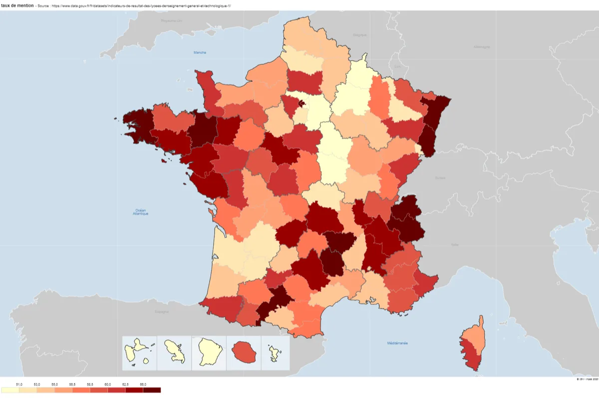
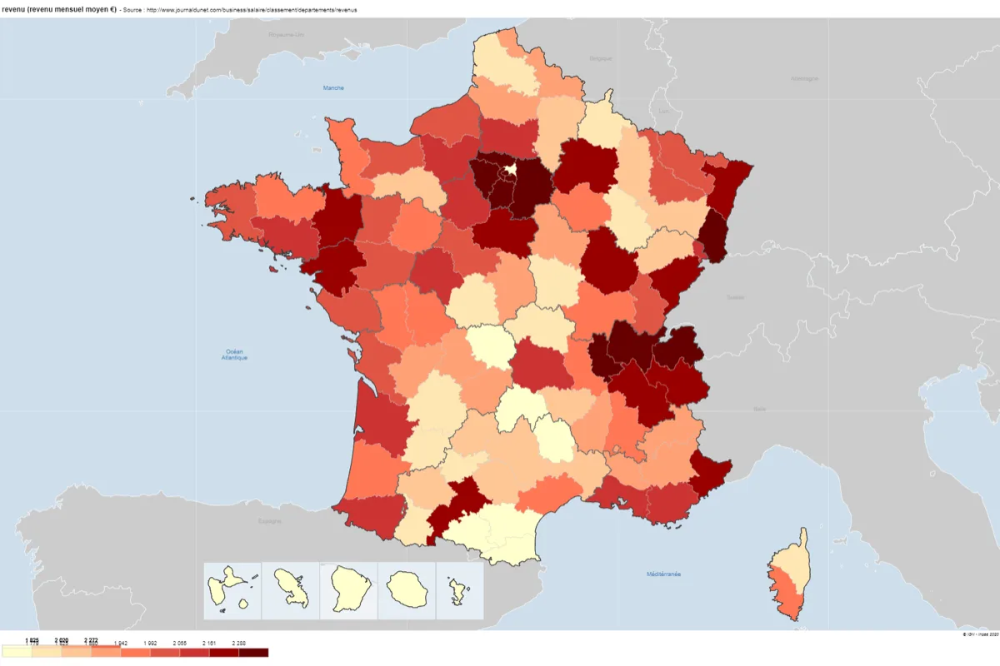
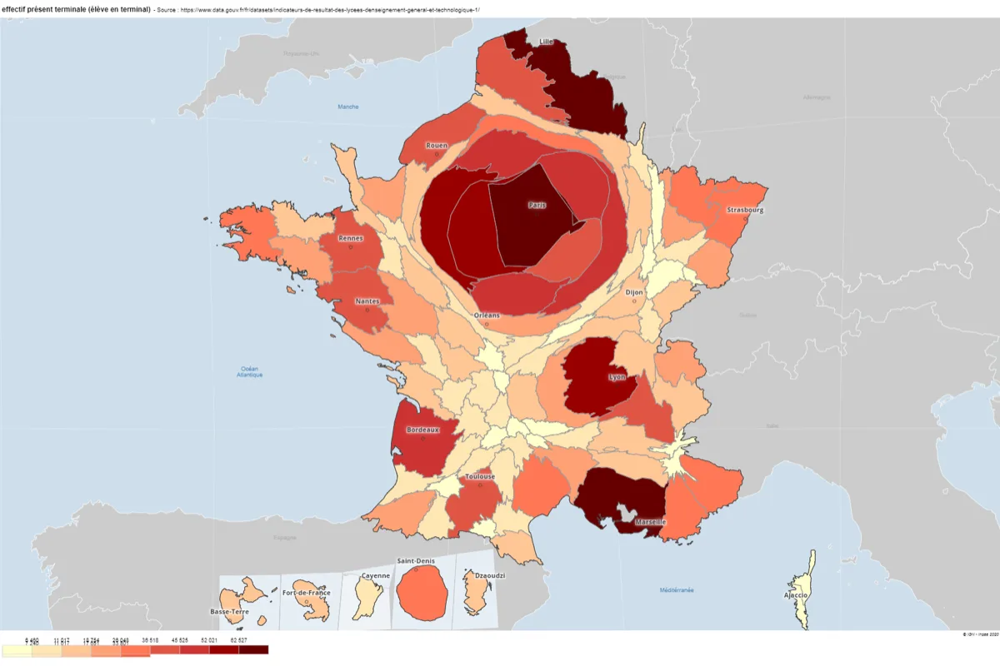

# Does household income line up with baccalauréat results? France, 2012–2019

**Question:** do baccalauréat results in France vary with the average income of the département where students sit their exams?

This is a statistical study written in R. It joins French lycée baccalauréat results (2012–2019) to average monthly income per département, then compares the two with maps and correlations. The original analysis is in French and is kept in [ANALYSE_FR.md](ANALYSE_FR.md).

## Maps

The two maps below cover the same départements: the baccalauréat mention rate (taux de mention) on the left, and average monthly income on the right.

  
  

  

The cartogram sizes each département by its number of students in final year, which makes large-population areas (Paris, Lyon, Marseille) visible. The gradient maps are better for comparing rates and averages.

## Key findings

The repository does not yet state a conclusion. What it establishes:

- **Scope:** results from 2012 to 2019 for general and technological lycées, using the education-ministry indicators on data.gouv.fr. The 2019 data is incomplete because the exams had not yet taken place when the dataset was compiled.
- **Income link:** each lycée's département is matched to its average monthly income, so results can be compared across regions.
- **Correlations:** `scriptprojetbac.R` computes Pearson correlations between départemental income and mention rates for eight baccalauréat series. The coefficients are not reported in the README, so no effect size is claimed here.
- **Spatial disparities:** the author observes that results and income differ noticeably from one département to another, and uses maps to show this.

If you are reading this for a conclusion, see the open question under "Status".

## Tech stack

- **R** for the whole pipeline (`scriptprojetbac.R`)
- **R packages:** `corrplot`, `FactoMineR`, `psy`, `prettyR`, `gplots`, `zoom`, `ggplot2`
- **Maps:** produced with the INSEE cartography tool, basemap © IGN / INSEE 2020

## Repository layout

| Path | Contents |
| --- | --- |
| `scriptprojetbac.R` | Data cleaning, per-département income and mention rates, correlations, plots |
| `ANALYSE_FR.md` | Original French analysis (R Markdown export) |
| `projet_bac.csv` | Lycée results extract used in the study |
| `code et revenu et taux mention.csv` | Département codes, income, mention rate and headcount |
| `code.revenu.median.csv`, `Varmod_RP19682016.csv` | Additional income and variable tables |
| `docs/images/` | Charts used in this README (WebP) |
| `*.png` (root) | Original map exports |

## Getting started

1. Clone the repository and open `EAVD.Rproj` in RStudio, or set your working directory to the repository root.
2. Install the R packages listed above.
3. Run `scriptprojetbac.R`.

Note: the script reads a file named `fr-en-indicateurs-de-resultat-des-lycees-denseignement-general-et-technologique.csv` and `code et revenu.csv`. Neither name matches a file in the repository (`projet_bac.csv` and `code et revenu et taux mention.csv` are the included equivalents), so the paths need adjusting before the script runs end to end. I have not re-run the R code for this refresh.

## Status

Exploratory study, with no written conclusion yet. Open items:

- Report the correlation coefficients and their significance, and state a conclusion.
- Align the file names in the script with the files in the repository.
- The introduction of the French analysis says 2012–2018, while the data covers 2012–2019.

## Data sources

- Baccalauréat results: education-ministry indicators on data.gouv.fr (cited as INSEE in the original analysis).
- Average monthly income per département: Journal du Net (as cited in the original analysis).
